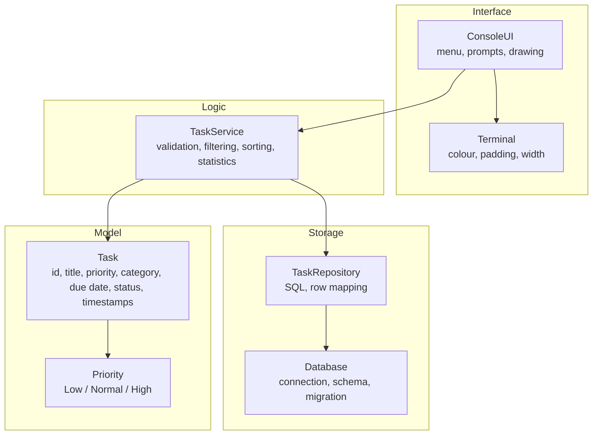
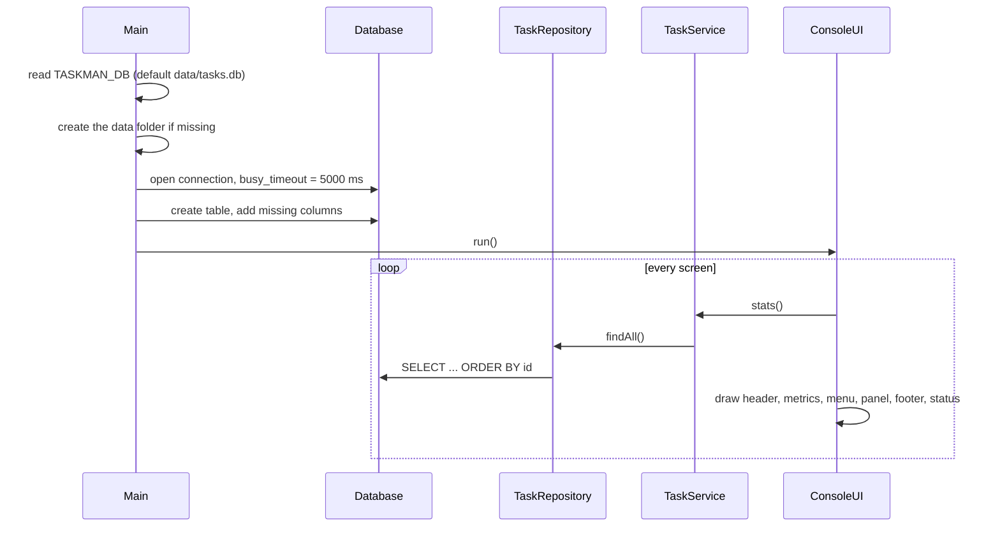
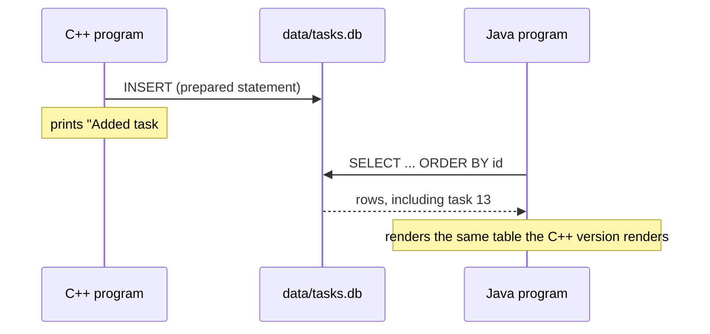

# Architecture

## Purpose

This is one task manager written twice: once in C++ and once in Java. Both
programs are terminal applications, both use the same SQLite database, and both
must look and behave the same. The point of the project is to show that the
same design can be implemented in two languages and still present one product
to the user.

The constraints that shape everything below:

1. One database file (`data/tasks.db`) shared by two processes.
2. The same features, menu, layout, messages, and task order in both programs.
3. No framework, no ORM, no build system beyond two PowerShell scripts.

## The parity contract

"Behaves the same" is a requirement, so it is written down and tested.

| Rule | Enforced by |
|---|---|
| Same menu, same screen layout, same status messages | `Assert-SameScreen` in `scripts/test-system.ps1` compares the full output of both programs, line by line, masking only the edition label |
| Same list order | Identical comparator in `TaskService::list` and `TaskService.list` |
| Same text limits | 200 characters for a title, 50 for a category, counted as Unicode code points in both |
| Same long-text handling | Text is cut at a code point and ends with `...` (`truncateText` / `truncate`) |
| Same row padding | Width is measured in code points, ignoring ANSI escapes (`Terminal::visibleLength` / `Terminal.visibleLength`) |
| Same date rules | `MM-DD` means the current year, `YYYY-MM-DD` is also accepted, years below 1900 are rejected, overdue means open and dated before today |
| Same bytes on screen | C++ writes UTF-8 directly; Java sets its `PrintStream` to UTF-8 so accented titles match |
| Same colour behaviour | ANSI is used only when stdin and stdout are both a console, or never when `NO_COLOR` is set |
| Same error text | Validation messages are identical strings in both programs |

Two tests in the suite hold this down: the screen comparison and an accented
title check. A change to one language that is not mirrored in the other fails
the suite.

## Layers

Both programs are split into the same four layers, with the same
responsibilities. The names differ only because of language conventions.



- **Model** — plain data plus the rules that belong to a value (priority
  codes, overdue check). No knowledge of SQL or the screen.
- **Storage** — every SQL statement in one place. `Database` owns the
  connection and the schema; `TaskRepository` maps rows to `Task` objects with
  prepared statements.
- **Logic** — `TaskService` is the only place that validates input, filters
  and sorts lists, and computes statistics. The interface never talks to the
  repository directly.
- **Interface** — `ConsoleUI` owns the menu, prompts and panels. `Terminal`
  wraps colour and text width so the drawing code contains no escape
  sequences.

### C++ files

| File | Role |
|---|---|
| `cpp/include/taskman/Task.hpp`, `cpp/src/Task.cpp` | `Task`, `Priority`, text helpers, date validation, clock |
| `cpp/include/taskman/Database.hpp`, `cpp/src/Database.cpp` | SQLite handle, schema creation, column migration |
| `cpp/include/taskman/TaskRepository.hpp`, `cpp/src/TaskRepository.cpp` | prepared statements, `Statement` RAII wrapper |
| `cpp/include/taskman/TaskService.hpp`, `cpp/src/TaskService.cpp` | validation, filtering, sorting, statistics |
| `cpp/include/taskman/ConsoleUI.hpp`, `cpp/src/ConsoleUI.cpp` | screens, prompts, panels, main loop |
| `cpp/include/taskman/Terminal.hpp`, `cpp/src/Terminal.cpp` | ANSI detection, colour, padding |
| `cpp/src/main.cpp` | wiring: environment, database, repository, service, UI |

### Java files

| File | Role |
|---|---|
| `Task.java`, `Priority.java` | model (a record and an enum) |
| `Database.java` | JDBC connection, schema creation, column migration |
| `TaskRepository.java` | prepared statements, row mapping |
| `TaskService.java` | validation, filtering, sorting, statistics |
| `ConsoleUI.java` | screens, prompts, panels, main loop |
| `Terminal.java` | ANSI detection, colour, padding |
| `Main.java` | wiring, UTF-8 stdout |

The C++ version is a set of translation units compiled by a script. The Java
version is twelve classes in one package folder, compiled by `javac`. Neither
uses a dependency manager: C++ links the SQLite amalgamation, Java loads
`sqlite-jdbc` from `java/lib`.

## Data model

One table, no joins, no indexes beyond the primary key.

```sql
CREATE TABLE tasks (
    id INTEGER PRIMARY KEY AUTOINCREMENT,
    title TEXT NOT NULL,
    priority INTEGER NOT NULL DEFAULT 2,
    category TEXT NOT NULL DEFAULT 'General',
    due_date TEXT NOT NULL DEFAULT '',
    done INTEGER NOT NULL DEFAULT 0,
    created_at TEXT NOT NULL DEFAULT '',
    completed_at TEXT NOT NULL DEFAULT ''
);
```

| Column | Meaning |
|---|---|
| `id` | Primary key, assigned by SQLite |
| `title` | 1 to 200 characters, trimmed |
| `priority` | `1` low, `2` normal, `3` high |
| `category` | 1 to 50 characters, `General` when blank |
| `due_date` | `YYYY-MM-DD`, or empty for none |
| `done` | `0` open, `1` complete |
| `created_at` | UTC ISO 8601, set once when the task is created |
| `completed_at` | UTC ISO 8601 when completed, cleared when reopened |

Dates and timestamps are text. That keeps the schema identical in both
languages with no driver-specific date types, sorting as plain strings, and the
database readable from any SQLite tool.

### Schema migration

Both programs run the same startup sequence:

1. `CREATE TABLE IF NOT EXISTS tasks (...)`.
2. Read `PRAGMA table_info(tasks)`.
3. `ALTER TABLE ... ADD COLUMN` for every column that is missing, with the same
   default the empty table would have.
4. Fill empty `created_at` values with the current UTC time.

So a database written by an older build, or by the other language, is brought
up to the current shape on open. There is no migration table and no version
number; the column list is the version.

## Flows

### Startup



### One task, two programs



Writes are small single statements. Reads happen on every redraw, so the other
program sees a change the next time it draws a screen; there is no cache and no
refresh key.

## Rendering

The interface is built from strings: `ConsoleUI` assembles each line, and
`Terminal` decides how colour is applied and how wide a string really is.

- `paint` returns the text unchanged when colours are off, so the same code
  produces plain output when piped.
- `visibleLength` counts code points and skips ANSI sequences, so a bold or
  coloured cell pads to the same column as an unstyled one.
- `truncateText` cuts long titles and categories at a character boundary and
  adds `...`, so a cut never leaves a broken byte sequence.
- Fixed geometry (`kWidth = 88`, metric boxes, menu boxes, the task table) keeps
  the two implementations easy to compare — the test compares whole screens, so
  any difference in padding shows up immediately.

The console is cleared and the screen redrawn after each action. When the
output is redirected, clearing is skipped and the log is plain text, which is
what the test suite reads.

## Concurrency

The database is the only shared state, and SQLite is used in its default mode
with a 5-second busy timeout in both programs.

- Reads are independent; both programs can list at the same time.
- Writes are short: one `INSERT`, `UPDATE`, or `DELETE` per action.
- Toggle is a read-then-write: the task is loaded, flipped, and saved. If both
  programs toggle the same task in the same instant, the last save wins. For the
  intended use — one person, one window at a time — that is acceptable, and the
  code does not try to solve it.
- `clear completed` and `delete` re-check affected rows so a stale screen cannot
  silently delete more than it showed.

## Tests

`scripts/test-system.ps1` builds both programs, points them at
`data/test-suite.db`, and drives them through stdin, one scripted session per
program. It asserts on the printed screen, not on internals:

- add, list, edit, toggle, delete, clear completed
- validation failures (empty title, impossible date, unknown ID)
- priority codes and sorting
- cross-language reads: a task added in C++ is visible in Java and the reverse
- one full-session comparison of both screens

The suite is end to end on purpose. The behaviour lives in the printed screen,
that is what a user and a marker see, and it is the only layer both languages
share.

## Build and release

| Step | C++ | Java |
|---|---|---|
| Compile | `scripts/build-cpp.ps1` — WinLibs `g++`, C++17, static link, SQLite amalgamation compiled once and cached | `scripts/build-java.ps1` — `javac --release 17`, classes to `java/out` |
| Run | `scripts/run-cpp.ps1` | `scripts/run-java.ps1` |
| Output | `build/cpp/task-cpp.exe` (self-contained) | `java/out/*.class` + `java/lib/*.jar` |

The release package (`task-manager-demo.zip`) contains only runnable artefacts:
the two programs, the SQLite driver, the demo database, two small launchers, and
the user documentation. The source is not in the zip; it lives in this
repository.

## Decisions and trade-offs

| Decision | Why | Cost |
|---|---|---|
| Duplicate the whole design in two languages | The assignment is to show the same product in two languages; sharing a library would hide half the work | Every behaviour change must be made twice |
| Dates as `YYYY-MM-DD` text | Identical schema and comparison in both languages, readable in any SQLite tool | No time zones per task; all dates are local calendar dates |
| Filtering and sorting in the service, not SQL | One comparator, written once per language, easy to keep identical | The whole table is read for each list or statistics call |
| Prepared statements everywhere | Titles and categories are user input; string-built SQL would be an injection hole | Slightly more code than `printf`-style queries |
| Column-list migration instead of a migration table | One file, no tooling, works when the other language created the file | No record of past versions |
| ANSI only when both ends are a console | Piped output stays clean, so screens can be diffed | Colour is off in odd setups such as a redirected stdin |
| No ORM, no dependency manager | Nothing to install for C++ beyond the compiler; Java needs one jar | SQL and mapping are written by hand |
| Demo data created through the program | Every rule (dates, priorities, timestamps) is applied by the real code path | Rebuilding the demo requires a scripted session |

## Known limits

- One user at a time. Two windows can both read; simultaneous edits to the same
  task resolve as last-write-wins.
- The list, search, and statistics read the whole table. Fine for hundreds of
  tasks, not designed for hundreds of thousands.
- Column width assumes one character per cell. East Asian wide characters and
  emoji still take two columns on screen, so a table row can look wide even
  though the width calculation is correct for Latin and accented text.
- The scripts are PowerShell and the C++ build is tuned for the WinLibs
  toolchain on Windows; the sources themselves are portable C++17 and Java 17.
- No unit tests: the suite drives the real programs, which is the layer where
  the two languages must agree.
